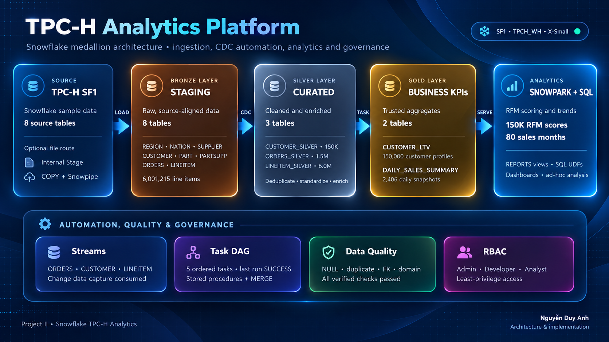
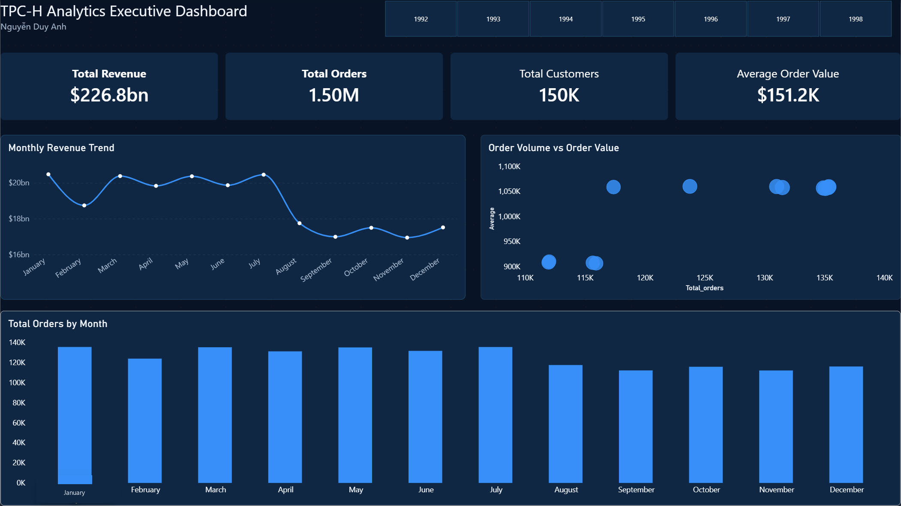
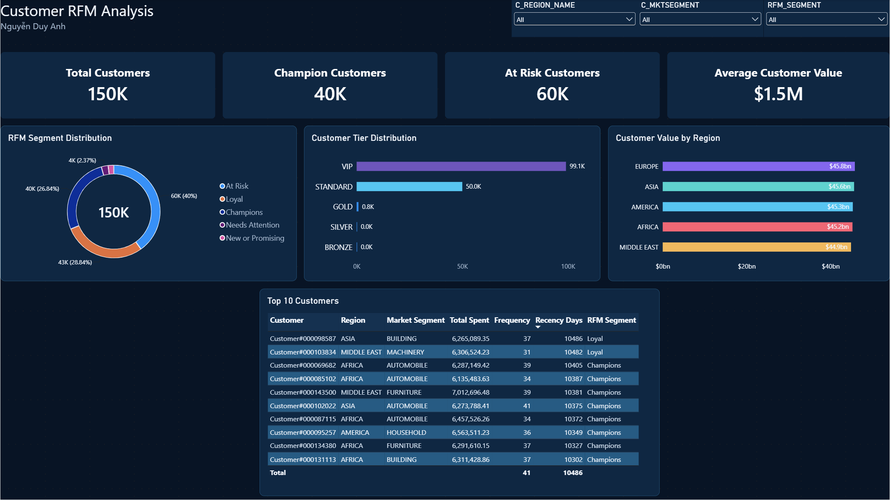

# Snowflake TPC-H Analytics Platform

An end-to-end analytics engineering portfolio project built on Snowflake using
TPC-H SF1. It implements a Medallion-style data platform, automated incremental
processing, data-quality controls, Snowpark analytics, SQL UDFs, and a two-page
Power BI dashboard.

**Author:** Nguyễn Duy Anh  
**Target roles:** Data Engineer · Analytics Engineer · BI Developer



## Project highlights

- Modelled **8 Bronze**, **3 Silver**, **2 Gold**, and **2 Analytics** tables.
- Processed **1.50M orders**, **6.00M line items**, and **150K customers**.
- Built a five-step task DAG using Snowflake Streams, Tasks, stored procedures,
  and idempotent `MERGE` operations.
- Verified an incremental order from file upload through Stage, Bronze, Stream,
  Silver, and Gold using test key `900000001`.
- Added RBAC for administrator, developer, analyst, and read-only viewer roles.
- Implemented NULL, duplicate, referential-integrity, domain, and layer
  reconciliation checks with zero recorded violations on the baseline run.
- Produced 150K customer RFM profiles and 80 monthly sales-trend rows with
  Snowpark Python.
- Built a Power BI report with executive and customer-RFM analysis pages.

## Architecture

```text
TPC-H SF1 / files
        |
        v
Internal Stage -> COPY / Snowpipe -> Bronze (STAGING)
                                      |
                                   Streams
                                      |
                                Task DAG + MERGE
                                      |
                         +------------+------------+
                         |                         |
                      Silver                    Gold
             cleaned and enriched       trusted business KPIs
                         |                         |
                         +------------+------------+
                                      |
                           Snowpark + SQL UDFs
                                      |
                         Power BI / ad-hoc SQL
```

The detailed architecture and task flow are available in
[docs/architecture_detailed.png](docs/architecture_detailed.png).

## Dashboard

### Executive overview



### Customer RFM analysis



The editable report is available at
[`powerbi/tpch_analytics_dashboard.pbix`](powerbi/tpch_analytics_dashboard.pbix),
with a portable two-page export at
[`powerbi/dashboard_report.pdf`](powerbi/dashboard_report.pdf).

## Measured results

| Metric | Result |
|---|---:|
| Bronze orders | 1,500,000 baseline + 1 incremental test row |
| Bronze line items | 6,001,215 |
| Customers | 150,000 |
| Monthly trend rows | 80 |
| Total revenue | 226.8B |
| Average order value | 151.2K |
| Snowpark RFM rows | 150,000 |
| SQL UDF tests | 7/7 passed |
| Task DAG | 5/5 tasks succeeded |
| Required data-quality violations | 0 |

See [execution evidence](docs/execution_evidence.md) for the recorded query
results and screenshots referenced by the original project submission.

## Repository structure

```text
.
|-- assets/                         # Portfolio-ready dashboard previews
|-- docs/                           # Architecture, case study and evidence
|-- evidence/                       # Curated screenshots from the real run
|-- powerbi/                        # PBIX and two-page PDF export
|-- scripts/validate_repo.py        # Offline repository validation
|-- snowpark/
|   |-- rfm_and_sales_trends.py
|   `-- worksheet_handler.py
|-- sql/
|   |-- 01_setup_and_ingestion.sql
|   |-- 02_medallion_pipeline.sql
|   |-- 03_data_quality_and_profiling.sql
|   `-- 04_udfs.sql
|-- test_data/                      # One-row incremental test fixture
|-- .env.example
|-- requirements.txt
`-- README.md
```

## Quick start

### Prerequisites

- A Snowflake account allowed to create databases, warehouses, roles, tasks,
  streams, pipes, and stored procedures.
- Access to `SNOWFLAKE_SAMPLE_DATA.TPCH_SF1`, or the eight standard TPC-H data
  files.
- Python 3.11+ for local Snowpark execution.
- Power BI Desktop to open the optional dashboard file.

### 1. Create the Snowflake environment

Run the scripts in order from a Snowsight worksheet:

```text
sql/01_setup_and_ingestion.sql
sql/02_medallion_pipeline.sql
sql/03_data_quality_and_profiling.sql
sql/04_udfs.sql
```

The first script contains separate role sections for `SECURITYADMIN`,
`SYSADMIN`, and `TPCH_ADMIN`. Review the comments before executing it.

### 2. Run Snowpark locally

```bash
python -m venv .venv
# Windows: .venv\Scripts\activate
# macOS/Linux: source .venv/bin/activate
pip install -r requirements.txt
copy .env.example .env
python snowpark/rfm_and_sales_trends.py --connection default
```

Use a named Snowflake connection whenever possible. Environment variables are
supported as a fallback. Never commit `.env`, `connections.toml`, passwords,
private keys, or tokens.

For execution directly inside Snowsight, create a Python Worksheet, paste
`snowpark/worksheet_handler.py`, select handler `main`, and run it with role
`TPCH_ADMIN` and warehouse `TPCH_WH`.

### 3. Reproduce the incremental test

Follow [docs/incremental_test.md](docs/incremental_test.md) using
`test_data/incremental_orders_900000001.tbl`. The expected outcome is:

1. one new file appears under the orders stage prefix;
2. one row is loaded into Bronze;
3. the orders stream triggers the task DAG;
4. order `900000001` appears in Silver;
5. customer and daily-sales Gold aggregates are refreshed;
6. all three source streams return `FALSE` after consumption.

## Engineering decisions

- **Idempotent transformations:** stored procedures use `MERGE` so reruns do
  not duplicate business keys.
- **Incremental processing:** tasks run only when `SYSTEM$STREAM_HAS_DATA`
  reports pending changes.
- **Separation of concerns:** Bronze preserves source-aligned records, Silver
  standardizes/enriches them, and Gold exposes business aggregates.
- **Least privilege:** role hierarchy separates platform ownership, pipeline
  development, analytics, and report consumption.
- **Cost control:** the X-Small warehouse auto-suspends after 60 seconds; the
  root task is suspended after testing.
- **Honest performance reporting:** Query Profile metrics are recorded, but no
  clustering improvement is claimed because no controlled before/after
  experiment was performed.

## Local validation

Run the repository check before committing:

```bash
python scripts/validate_repo.py
```

The same check runs automatically in GitHub Actions.

## Selected execution evidence

| Capability | Evidence |
|---|---|
| Bronze baseline | [TPC-H SF1 row counts](evidence/01_bronze_row_counts.png) |
| File ingestion | [Incremental file on Internal Stage](evidence/01_internal_stage_incremental_file.png) |
| Access control | [Project roles](evidence/01_roles.png) · [Developer grants](evidence/01_developer_grants.png) |
| Automation | [Five-task execution history](evidence/02_task_history.png) |
| Incremental Silver | [Order 900000001](evidence/02_incremental_silver_order.png) |
| Incremental Gold | [Customer LTV](evidence/02_incremental_customer_ltv.png) · [Daily sales](evidence/02_incremental_daily_sales.png) |
| Data quality | [Layer reconciliation](evidence/03_layer_reconciliation.png) |
| Performance | [Snowflake Query Profile](evidence/03_query_profile.png) |
| Snowpark and UDFs | [Snowpark success](evidence/04_snowpark_success.png) · [7/7 UDF tests](evidence/04_udf_tests.png) |

## Security and data notes

- TPC-H is synthetic benchmark data; no personal customer data is included.
- Secrets and local Snowflake connection profiles are excluded by `.gitignore`.
- The PBIX may require signing in to your own Snowflake account before refresh.
- The recorded implementation used Snowflake sample data for the initial load
  and a staged file for the incremental-path verification.

## License

Released under the [MIT License](LICENSE).
